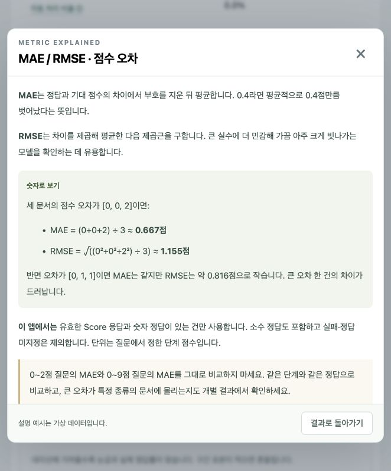

# 판단 실험실 · Decision Model Lab

**내 Mac의 AI 모델 여러 개에 같은 질문을 주고, 답의 정확도·확신·속도를 웹 화면에서 비교하는 앱입니다.**

예를 들어 고객 문의를 ‘결제 / 기술 / 계정’으로 분류하거나, 문의의 긴급도를 점수로 매기거나, ‘환불 요청인가?’를 판단하게 할 수 있습니다. 모델을 바꾸어 같은 시험을 치르게 한 다음, 어떤 모델이 내 업무에 맞는지 확인합니다.

앱은 한국어 화면으로 제공되며 **Python 표준 라이브러리만으로 실행**됩니다. 앱 실행에는 `pip install`, Node.js, 프런트엔드 빌드가 필요 없습니다. 실제 AI 판단을 하려면 Ollama·Ollaya·llama.cpp 중 지원되는 로컬 모델 서버와 모델 가중치를 별도로 준비해야 합니다.

> 이 저장소에는 앱 코드·예제·완성 리포트가 들어 있습니다. 수 GB 크기의 모델 파일과 개인 실험 데이터는 포함하지 않습니다. 처음 받은 컴퓨터에 모델이 이미 설치되어 있다고 가정하지 않습니다.

## 원하는 내용 바로 찾기

- [처음 실행하기](#처음-실행하기)
- [Choice·Score·Noul 이해하기](#choice-score-noul은-무엇인가요)
- [첫 평가 따라 하기](#첫-평가-따라-하기)
- [어떤 모델을 연결하나요?](#어떤-모델을-연결하나요)
- [결과와 지표 읽기](#결과와-지표-읽기)
- [저장한 파일의 차이](#저장한-파일의-차이)
- [다른 Mac으로 옮기기](#다른-mac으로-옮기기)
- [폴더와 코드 구조](#폴더와-코드-구조)
- [Git에 올리기](#git에-올리기)
- [자주 생기는 문제](#자주-생기는-문제)
- [개발·검증·리포트](#개발-검증-리포트)

## 처음 실행하기

### 1. 준비물 확인

| 필요한 것 | 설명 |
|---|---|
| Mac + Python 3.9 이상 | 앱 서버를 실행합니다. [Python 공식 Mac 설치](https://www.python.org/downloads/macos/)에서 받을 수 있습니다. |
| 최신 브라우저 | Safari, Chrome, Edge 등에서 화면을 엽니다. |
| Ollama 또는 지원되는 로컬 서버 | AI 모델을 실제로 실행하는 프로그램입니다. [Ollama Mac 설치](https://ollama.com/download/mac)를 참고하세요. |
| Apple Silicon + macOS 14 이상 | 이 앱의 **Ollaya 0.9.0 준비 도우미**를 사용하는 조건입니다. Intel Mac에서는 Ollama·llama.cpp 연결을 이용합니다. |
| 인터넷과 디스크 여유 공간 | 기본 모델 4종을 처음 받을 때 필요합니다. 준비 도우미는 여유 공간 15GB 이상을 확인하며 모델 다운로드는 약 10GB 이상입니다. 실제 크기는 배포 버전에 따라 달라집니다. |

모델 가중치는 ‘AI가 학습한 내용이 담긴 큰 파일’입니다. 처음 한 번 받아 두면 이후 추론은 로컬 서버에서 수행합니다. 처리 속도와 메모리 사용량은 Mac 사양, 모델 크기, 문서 길이에 따라 달라집니다.

### 2. Finder에서 실행하기

1. 저장소를 내려받아 압축을 풀거나 Git으로 복제합니다. 폴더 이름은 `decision_model`이어도 되고 다른 이름이어도 됩니다.
2. **처음 한 번 `setup.command`를 두 번 누릅니다.** Python이나 Ollama가 없으면 설치 안내를 따르고 다시 실행합니다. 모델 준비에 동의하면 Ollaya 실행기와 기본 모델을 준비합니다.
3. **`start.command`를 두 번 누릅니다.** 앱과 필요한 로컬 서버를 시작하고 자유 성능평가 화면을 엽니다.
4. 실행된 터미널 창을 열어 둡니다. 종료할 때 그 창에서 **Ctrl+C**를 누릅니다.

macOS가 파일 열기를 막으면 Finder의 ‘열기’ 또는 시스템 설정의 정상적인 승인 절차를 이용하세요. 파일을 옮기며 실행 권한이 사라졌다면 터미널에서 프로젝트 폴더로 이동해 `chmod +x start.command setup.command`를 실행할 수 있습니다.

### 3. 터미널을 사용한다면

아래 명령은 **README가 있는 프로젝트 폴더 안에서** 실행합니다.

```sh
python3 --version
python3 setup_mac.py --check
python3 setup_mac.py
python3 run.py
```

- `--check`: 설치 상태만 확인합니다. 프로그램이나 모델을 설치하지 않습니다.
- `setup_mac.py`: 최초 준비입니다. 이미 있는 모델은 다시 받지 않고, 필요한 기본 모델을 내려받습니다.
- `run.py`: 일상적인 실행입니다. 모델 가중치를 자동 다운로드하지 않습니다.

브라우저가 자동으로 열리지 않으면 [자유 성능평가](http://127.0.0.1:8765/evaluation)를 엽니다. 모델이 없어도 아래 명령으로 화면과 설명부터 볼 수 있습니다. 실제 평가에는 모델 연결이 필요합니다.

```sh
python3 server.py
```

앱 서버를 직접 실행한 경우 배포 ZIP은 `python3 package_app.py`로 먼저 만들어야 웹의 ZIP 다운로드를 사용할 수 있습니다. `run.py`는 ZIP이 없으면 만들어 줍니다.

## Choice, Score, Noul은 무엇인가요?

| 유형 | 쉬운 뜻 | 질문 예시 | 사람이 붙이는 정답 |
|---|---|---|---|
| **Choice** | 이름이 있는 선택지 중 하나 고르기 | ‘어느 부서가 처리할 문의인가?’ | `billing`, `technical`, `account` 등 선택지 ID |
| **Score** | 순서가 있는 단계로 점수 매기기 | ‘얼마나 긴급한가?’ | 일반=0, 주의=1, 긴급=2 같은 숫자 |
| **Noul** | 하나의 명제가 참일 확률 구하기 | ‘이 문서는 환불을 요청한다’ | `true` 또는 `false` |

**Score의 점수는 소수일 수 있습니다.** 0·1·2점의 확률이 각각 10%·60%·30%라면, 평균적인 기대 점수는 `0×0.1 + 1×0.6 + 2×0.3 = 1.2점`입니다. 가장 유력한 단계인 ‘1점’과 기대 점수 ‘1.2점’은 다른 값입니다.

**Noul의 확률은 최종 결정과 구분합니다.** 참일 확률이 0.6이고 판정 기준이 0.5라면 참으로 분류합니다. 기준을 0.7로 높이면 같은 응답도 거짓으로 분류합니다. 기준을 바꾸는 것은 AI에게 다시 질문하는 일이 아닙니다.

## 첫 평가 따라 하기

처음에는 **Choice의 기본 예제 6건과 모델 1개**로 시작하세요. 연결이 확인되면 모델 수와 문서 수를 늘리면 됩니다. 6건은 기능 체험용이며 업무 성능을 확정하기에는 작은 표본입니다.

1. [자유 성능평가 화면](http://127.0.0.1:8765/evaluation)을 열고 **Choice**를 선택합니다.
2. 질문에 ‘이 문의를 처리할 담당 부서를 선택하세요’라고 씁니다. 아래 선택지는 한 줄에 하나씩 입력합니다.

   ```text
   billing = 결제, 청구, 환불
   technical = 오류, 장애, 기능 문제
   account = 계정, 로그인, 회원 정보
   ```

3. **이 유형의 예제 넣기**를 누르거나 문서를 직접 입력합니다. 각 문서의 정답을 사람이 확인합니다. 정답을 모르면 ‘정답 미지정’을 선택할 수 있지만 해당 문서는 정확도를 채점하지 않습니다.
4. **설치된 모델 찾기**를 누릅니다. 비교할 모델을 선택하고 ‘결과를 받는 방식’을 확인합니다. 모델을 선택해도 자동으로 다운로드하지 않습니다.
5. 첫 실행은 반복 횟수 1, 준비 실행 없음으로 시작합니다. ‘첫 로딩 포함’이므로 처음 모델을 메모리에 올리는 시간이 결과에 들어갈 수 있습니다.
6. **선택한 모델 평가하기**를 누릅니다. 모든 모델에 같은 입력을 주며, 모델별로 순서대로 실행합니다.
7. 결과 카드와 비교표를 봅니다. **지표명 옆 ⓘ** 또는 그래프의 **설명**을 누르면 숫자 예시와 해석 요령을 바로 확인할 수 있습니다.
8. ‘문서 하나를 골라 나란히 비교’에서 같은 문서에 대한 모델별 답을 확인합니다. 총점이 비슷해도 어떤 문서에서 틀리는지는 다를 수 있습니다.
9. 새로고침하기 전에 필요한 **질문·데이터 저장**, **결과 JSON**, **지표 CSV**를 내려받습니다.

화면에 표시되는 예제와 같은 형식의 JSON은 [examples 폴더](examples/)에도 있습니다. 해당 유형을 선택한 후 **‘데이터 JSON 읽기’**로 가져오세요. 이 파일은 문서와 정답만 담으므로 질문·선택지는 [예제 안내](examples/README.md)에 맞춰 설정합니다. 상단 ‘실험 불러오기’는 전체 실험 저장 파일용으로 용도가 다릅니다.



### 실험 조건은 언제 바꾸나요?

| 설정 | 처음 사용할 때 이해할 점 |
|---|---|
| 문서당 반복 횟수 | 같은 요청을 여러 번 보냅니다. 같은 문서의 반복을 새로운 독립 문서로 해석하지 마세요. |
| 모델별 준비 실행 | 첫 문서로 1회 예열할 수 있습니다. 준비 실행은 측정 지표에서 제외하고 성공·실패 기록을 따로 남깁니다. |
| 문서 실행 순서·시드 | 입력 순서 또는 재현 가능한 섞기를 선택합니다. 모든 모델에 같은 문서 순서를 적용합니다. 모델 순서는 고정입니다. |
| 응답 제한 시간 | 오래 걸리는 요청을 언제 실패로 처리할지 정합니다. |
| Ollama 입력 공간 | 질문과 문서를 처리할 토큰 공간입니다. 너무 큰 값은 메모리 부담을 높일 수 있습니다. |
| 토큰 확률 보정 온도 | 일반 LLM의 토큰 확률을 변환하는 설정입니다. 기본 1에서 시작하고, 보정용 데이터로 선택한 값을 별도 평가 데이터에서 확인하세요. |
| 인간 검토 기준 | 이 값보다 확신도가 낮으면 사람이 볼 대상으로 집계합니다. 기준과 같은 값은 자동 처리 후보입니다. |
| ECE 구간 수 | 비슷한 확률의 응답을 몇 구간으로 묶어 보정 오차를 볼지 정합니다. 모델 간 비교에서는 같은 수를 사용합니다. |

결과 영역의 임계값·ECE 구간·ROC 대상 클래스는 **이미 받은 응답을 다시 집계**합니다. 질문·선택지·문서·모델을 바꾼 새 실험은 평가 버튼으로 다시 실행해야 합니다.

## 어떤 모델을 연결하나요?

### 실행 도구와 모델은 다릅니다

**Ollama·Ollaya·llama.cpp는 모델을 실행하는 도구**, Qwen·JevK5·Laya·decider는 그 도구가 읽는 모델입니다. 동영상 플레이어와 동영상 파일의 관계를 떠올리면 쉽습니다.

| 연결 방식 | 기본 주소 | 이 앱에서 받는 결과 |
|---|---|---|
| Ollama | `http://127.0.0.1:11434` | 답 토큰의 확률 또는 JSON으로 생성한 답·확률 |
| Ollaya | `http://127.0.0.1:11435` | 전용 Choice·Score·Noul 응답 |
| llama.cpp / 로컬 호환 서버 | 서버에 설정한 주소, 예: `http://127.0.0.1:8080` | 호환 API의 답 토큰 확률 또는 JSON 응답 |

Ollama 모델 목록에는 판단에 적합하지 않은 임베딩 모델도 나타날 수 있습니다. **목록에 보인다고 모든 평가 방식을 지원하는 것은 아닙니다.** 필요한 로그확률이나 JSON 형식을 제공하지 못하면 실패로 기록합니다.

**답 토큰의 확률**은 AI가 다음 답 후보에 부여한 점수를 읽는 방식입니다. **JSON 확률**은 AI에게 확률 숫자를 써 달라고 요청하는 방식입니다. 후자의 숫자는 자체 평가이며 실제 정답률과 맞는지 별도로 검증해야 합니다. 이 두 방식의 숫자를 같은 성격의 확률로 가정하지 마세요.

### 준비 도우미의 기본 모델

| 모델 이름 | 실행 도구 | 비교하는 역할 |
|---|---|---|
| `qwen3.5:4b` | Ollama | 일반 언어 모델의 답 후보 확률을 판단에 사용하는 기준점 |
| `jevk5:latest` | Ollaya | 전용 판단 인터페이스를 사용하는 JevK5 |
| `laya:multilingual` | Ollaya | 다국어 판단 모델 |
| `decider:0.8b` | Ollaya | 상대적으로 작은 판단 모델 |

이 표는 앱의 준비 목록이며 성능 순위가 아닙니다. 자유 성능평가에서는 목록 외의 로컬 모델도 직접 추가할 수 있습니다. 해당 실행기의 API 계약을 지원하는지 확인하세요.

**JevK5와 TypeSafe의 클라우드 Jev는 서로 다른 모델입니다.** 이 앱은 클라우드 Jev에 연결하지 않습니다. 영상·글의 모델 버전, 데이터, 하드웨어와 지금의 환경도 다를 수 있습니다.

### 이미 모델 서버를 사용 중이라면

`run.py`는 실행 중인 로컬 서버를 재사용합니다. 그 서버의 모델 저장 위치와 설정이 적용됩니다. 이미 설치한 모델만 시험하려면 `setup.command`의 기본 4종 다운로드를 건너뛰고 `start.command`로 실행해 연결하면 됩니다.

앱이 서버를 새로 시작할 때는 프로젝트 안의 `.models/`와 `.ollaya-models/`를 사용합니다. 예전 프로젝트 안에만 설치된 모델은 새 폴더에 자동 복사되지 않습니다. 기존 서버를 연결하거나 새 폴더에서 준비 도우미를 실행하세요.

## 결과와 지표 읽기

처음에는 **① 실패 여부 → ② 정확도와 놓친 종류 → ③ 확신의 신뢰성 → ④ 자동 처리 범위 → ⑤ 속도** 순서로 보세요. `—`는 0점이 아니라 계산에 필요한 자료가 없다는 뜻입니다.

| 지표 | 쉽게 말하면 | 해석 방향 |
|---|---|---|
| Accuracy | 정답이 있는 정상 응답 중 몇 개를 맞혔나 | 높을수록 좋음. 한 종류만 많은 데이터에서는 착시가 생김 |
| Precision | 모델이 찾아냈다고 한 것 중 진짜는 몇 개인가 | 높을수록 불필요한 오탐이 적음 |
| Recall | 찾아야 하는 진짜 대상 중 몇 개를 찾았나 | 높을수록 놓침이 적음 |
| macro-F1 | 각 종류의 Precision·Recall 균형을 같은 비중으로 평가 | 드문 종류까지 잘 처리하는지 함께 확인 |
| ECE | ‘90% 확신’한 응답들이 실제로도 약 90% 맞는가 | 낮을수록 보정 간격이 작음. 오답률과 다름 |
| Brier | 확률 자체가 정답에서 얼마나 벗어났나 | 낮을수록 좋음. 자신 있게 틀리면 벌점이 큼 |
| 스키마 위반율 | 약속한 JSON·선택지·확률 형식을 어겼나 | 낮을수록 좋음. 연결 실패는 별도의 전체 실패율에서 확인 |
| p50 / p95 | 보통 얼마나 기다리며, 느린 요청은 얼마나 걸리나 | 낮을수록 빠름. p95는 95%가 이 시간 이내에 끝난다는 의미 |
| 인간 검토율 | 확신이 낮아 사람이 확인해야 할 비율 | 낮추는 것만 목표로 삼지 않고 자동 처리 정확도와 함께 확인 |
| Coverage / Selective Accuracy | 자동 처리 후보의 양 / 그 후보 중 맞힌 비율 | 자동화 범위와 그 안의 정확도를 함께 확인 |
| ROC-AUC / AP | 필요한 대상을 높은 점수 쪽에 잘 모으나 | 높을수록 구별 능력이 좋음. AUC 0.9가 정확도 90%라는 뜻은 아님 |
| MAE / RMSE | Score 기대 점수가 정답에서 얼마나 멀었나 | 낮을수록 좋음. RMSE는 큰 실수에 더 민감함 |

예를 들어 요청 100건 중 10건이 실패하고, 나머지 90건에서 72건을 맞히면 **Accuracy는 80%, 실패 포함 정답률은 72%**입니다. 같은 ‘정확도’처럼 보여도 무엇을 분모로 삼는지 다릅니다.

전체 설명은 [앱의 지표 읽는 법](http://127.0.0.1:8765/evaluation#metric-guide) 또는 [평가 상세 안내](docs/evaluation-reference.md)를 보세요. 웹 화면에는 26개 설명이 있으며 계산 예시·분모·주의점이 함께 들어 있습니다. 설명의 숫자는 가상 예시이며 실제 측정 결과와 구분됩니다.

## 저장한 파일의 차이

| 버튼 / 파일 | 담기는 내용 | 다시 가져올 수 있나요? |
|---|---|---|
| 질문·데이터 저장 | 원문, 정답, 질문, 선택지, 모델, 실행 설정 | **실험 불러오기**로 가져와 다시 평가 가능 |
| 데이터 JSON 읽기 / `examples/*.json` | 문서 이름, 원문, 정답의 배열 | 현재 선택한 유형의 데이터로 가져오기 가능 |
| 결과 JSON | 원문을 제외한 이름·정답·원문 해시, 모델 식별값, 설정, 응답, 실패와 집계값 | 현재 UI에서 결과를 재표시하는 가져오기 기능은 없음 |
| 지표 CSV | 현재 비교표의 지표와 숫자 | 스프레드시트 등에서 확인 |

질문·입력·결과는 자동 저장하지 않습니다. 새로고침·종료하면 사라집니다. 유형 사이를 이동할 때에는 유형별 작성 내용을 메모리에 유지합니다. 내보내기는 앱 서버 메모리에 다운로드를 잠시 준비한 뒤 파일로 받는 방식이며, 링크는 10분 동안 유효합니다.

개인 실험 파일은 이 폴더의 `experiments/`, 평가 결과는 `results/`에 보관하면 Git에서 제외됩니다. `.gitignore`는 지정된 경로와 파일 이름만 제외하므로 다른 이름으로 저장한 실제 문서까지 자동으로 구별하지는 않습니다.

## 다른 화면에는 무엇이 있나요?

[앱 첫 화면](http://127.0.0.1:8765/)에는 **기밀 문서 한 건 검토**, **기본 4종 모델 비교**, **종합 리포트·구조 설명**이 있습니다.

- 기밀 검토는 텍스트를 읽고 반출 가능 후보·사람 검토·반출 금지로 나눕니다. 주민등록번호·키 등의 형태를 먼저 찾는 규칙을 사용할 수 있습니다. ‘가능 후보’는 실제 반출 승인이 아닙니다.
- 기본 4종 비교는 기밀 판단이라는 공통 과제로 모델을 비교합니다. 모델 자체를 비교하기 위해 우선 규칙을 끕니다.
- 자유 성능평가는 질문·카테고리·선택지·정답을 직접 바꾸는 별도 페이지입니다.

자유 성능평가는 입력 1~100건, 선택지·단계 2~10개, 문서당 반복 1~10회, 총 측정 요청 1,000회까지입니다. 문서 한 건은 최대 12,000자이고 질문·선택지·원문 합계는 UTF-8 24KB 제한을 받습니다. 기본 4종 비교의 데이터 묶음 한도는 별도로 50건입니다. PDF·이미지 OCR은 지원하지 않으므로 텍스트로 준비하세요.

## 다른 Mac으로 옮기기

두 방법 중 편한 것을 사용하세요.

**Git으로 옮기기:** 저장소를 복제하고 `setup.command` → `start.command` 순서로 실행합니다. 모델 파일은 저장소에 없으므로 새 Mac에서 따로 준비합니다.

**앱 ZIP으로 옮기기:** 이 폴더의 `releases/decision-lab-mac.zip`을 복사해 압축을 풉니다. ZIP 안의 최상위 폴더 이름은 `decision-lab`입니다. 받은 Mac에서 동일하게 준비·시작 파일을 실행합니다.

코드나 문서를 수정한 뒤에는 ZIP을 다시 만드세요. 이미 있는 ZIP은 실행할 때 자동 갱신되지 않습니다.

```sh
python3 package_app.py
```

기본 ZIP은 앱 코드·설명서·예제·완성 리포트·테스트를 담습니다. `.git`, 개인 실험, 과거 실행 기록, 모델 가중치와 설치 실행기는 포함하지 않습니다. 개발용 보고서 생성기는 Git 저장소에서 이용합니다.

모델 가중치까지 직접 옮기려면 `python3 package_app.py --include-models`를 사용할 수 있습니다. **현재 폴더의 `.models/`와 `.ollaya-models/`에 있는 파일만** 포함하며 이미 실행 중인 다른 서버의 저장소는 가져오지 않습니다. Python·Ollama와 Ollaya 실행기는 받는 Mac에서 별도로 준비해야 합니다. 큰 묶음은 Git에 올리지 않습니다.

서로 다른 Mac의 결과를 비교할 때는 같은 질문·정답뿐 아니라 모델 digest(가중치 식별값), 실행기 버전, 준비 실행, 확률 방식도 맞추세요. 같은 모델 이름이라도 배포 태그가 갱신되면 내용이 달라질 수 있습니다.

## 폴더와 코드 구조

```text
decision_model/
├── README.md                    지금 읽는 시작 안내
├── start.command / setup.command   Finder에서 실행하는 파일
├── run.py                       앱·로컬 서버 시작과 종료 관리
├── setup_mac.py                 다른 Mac의 최초 준비
├── server.py                    웹 화면 제공, 요청 검사, 모델 연결
├── evaluation.py                Choice·Score·Noul 응답 변환·검증
├── package_app.py               다른 Mac용 ZIP 만들기
├── dist/                        실제 HTML·CSS·JavaScript 소스
├── tests/                       모델 없이 실행하는 자동 테스트
├── examples/                    가상 평가 입력과 사용 설명
├── docs/                        평가·코드 구조·Git 상세 설명, 화면 이미지
├── report/                      종합 리포트 Word·PDF, 생성 코드와 출처 목록
├── verification/                과거 검증 기록; 공개 예제 1개만 Git 포함
├── releases/                        생성한 ZIP; Git 제외
└── local-artifacts/             기존 조사 원문 보관; Git 제외
```

`dist`라는 이름이지만 **별도 빌드로 생성되는 폴더가 아닙니다.** 직접 편집하는 화면 소스이므로 Git에 포함해야 합니다. 폴더 전체를 지우고 다시 빌드하는 명령은 없습니다.

```text
사용자가 웹에서 질문·문서 입력
    ↓
evaluation.js가 평가 조건을 고정하고 모델별 요청
    ↓
server.py가 로컬 주소·입력 길이 등 검사
    ↓
evaluation.py가 Ollama / Ollaya / llama.cpp로 전달
    ↓
모델 답·확률·오류를 공통 형식으로 검증
    ↓
evaluation-metrics.js가 지표 계산 → 표·그래프로 표시
```

정답은 브라우저에서 채점할 때 쓰며 모델 질문에 넣지 않습니다. 확률이나 응답이 불완전하면 0점으로 꾸미지 않고 실패로 기록합니다. 함수별 한국어 주석과 [코드 구조 안내](docs/architecture.md)를 따라 읽을 수 있습니다.


## 자주 생기는 문제

| 증상 | 확인할 것 |
|---|---|
| `python3`를 찾을 수 없음 | Python 3.9 이상 설치 후 터미널을 다시 열거나 `setup.command`를 다시 실행합니다. |
| 모델 목록이 비어 있음 | 해당 서버가 켜져 있는지, 주소·포트가 맞는지 확인합니다. 앱 폴더의 모델과 기존 Ollama 서버의 저장소가 다를 수 있습니다. |
| Ollama는 연결되는데 전용 모델이 없음 | JevK5·Laya·decider 기본 모델은 Ollaya 쪽입니다. Apple Silicon/macOS 조건과 준비 도우미 완료 여부를 확인합니다. |
| 모델을 선택했지만 형식 오류가 남 | 임베딩 전용 모델인지, 필요한 로그확률 또는 JSON 계약을 지원하는지 확인합니다. 실패 유형을 펼쳐 보세요. |
| `—`가 많음 | 정답, 유효 응답, 양성·음성 표본이 충분한지 확인합니다. Score의 소수 정답은 MAE·RMSE에만 포함됩니다. |
| 첫 요청이 유난히 느림 | 모델 로딩 시간이 포함될 수 있습니다. 준비 실행 여부를 맞추고 이후 p50·p95와 표본 수도 함께 봅니다. |
| 입력 잘림 오류 | 질문·선택지를 포함한 입력이 모델 한도를 넘었을 수 있습니다. 문서를 나누세요. 앱의 글자 수 제한과 모델 토큰 한도는 다릅니다. |
| 새 폴더에서 실행했는데 예전 화면이 나옴 | `run.py`는 이미 실행 중인 8765 앱 서버를 재사용합니다. 기존 앱을 실행한 터미널에서 종료한 뒤 새 폴더에서 다시 실행하세요. |
| 8765 포트를 다른 프로그램이 사용함 | 해당 프로그램을 확인하거나 `python3 server.py --port 8766`으로 앱만 다른 포트에 띄웁니다. 이때 브라우저 주소도 8766으로 바꾸며 모델 서버는 따로 실행합니다. |
| 다운로드가 자동으로 시작되지 않음 | 화면에 나타나는 ‘준비된 파일 저장’ 링크를 직접 누릅니다. |
| 새로고침 후 결과가 사라짐 | 자동 저장을 하지 않는 현재 동작입니다. 다음 평가부터 실험·결과를 내려받아 보관하세요. |

## 개발, 검증, 리포트

### 자동 테스트

모델을 설치하거나 내려받지 않고 앱의 계산·응답 검증·오류 처리를 확인할 수 있습니다.

```sh
python3 -m unittest discover -s tests -p 'test_*.py'
node --test tests/*.test.cjs
```

JavaScript 테스트에만 Node.js 18 이상이 필요합니다. 앱 사용자에게는 필요 없습니다. 현재 테스트는 Python 30개와 JavaScript 13개입니다. 테스트 통과는 앱 구현을 확인한 것이며, 특정 모델의 업무 정확도를 보장하지 않습니다.

다른 폴더에서 실행하는 기본 동작과 ZIP 구성을 검증했습니다. **별도의 두 번째 실물 Mac에서 모든 모델을 설치·실행한 검증은 아직 아닙니다.** 과거 모델 실행 기록도 특정 날짜의 작은 가상 예제 결과이므로 모델 순위로 일반화하지 않습니다.

### 리포트와 자세한 문서

- [종합 리포트 Word](report/decision-models-report.docx) / [PDF](report/decision-models-report.pdf): 영상·GeekNews 글의 분석, 17개 모델 계열의 구조, 초기 앱 사용법. **2026-10-04 작성본**입니다.
- [평가 상세 안내](docs/evaluation-reference.md): Choice·Score·Noul, 지표 분모와 계산 예시, 저장 형식. 자유 평가 기능은 이 문서와 웹 안내를 우선 참고하세요.
- [코드 구조](docs/architecture.md): 요청 처리 흐름, 파일별 역할, 수정하는 위치.
- [Git 업로드 안내](docs/git-guide.md): 첫 저장소 연결, 변경 저장, ZIP 배포.
- [출처 목록](report/sources.json): 리포트 조사 당시 원문 주소와 조회 상태. `ok: false` 항목은 근거가 확보된 것으로 취급하지 않습니다.

보고서 생성용 `report/build_report.py`는 앱과 분리된 개발 도구입니다. `python-docx`가 필요하며 `verification/example-comparison.json`의 과거 가상 문서 실행 기록을 읽습니다. 수정 후 `python3 report/build_report.py`로 Word를 만들 수 있지만 **PDF는 자동 갱신되지 않습니다.** Word나 별도 문서 렌더러로 다시 내보내고 페이지 배치를 확인하세요. 문서용 글꼴 파일은 저장소에 포함하지 않습니다.

### 문서는 어디로 전송되나요?

앱 서버는 `127.0.0.1`에서만 열리고 모델 주소도 HTTP의 `localhost`·`127.0.0.1`만 허용합니다. 외부 CDN·분석 스크립트 없이 동작합니다. 앱이 직접 시작하는 Ollama는 클라우드 기능을 끄며 원격 모델 메타데이터도 검사합니다. 기존 모델 서버 자체의 로그·플러그인 동작까지 이 앱이 제어하지는 않습니다.

모델·실행기 최초 다운로드와 사용자가 여는 참고 링크는 인터넷을 사용합니다. 저장 버튼으로 받은 실험 파일에는 원문이 포함됩니다. 문서 분류 화면의 연결 설정 등은 브라우저에 남을 수 있지만 문서 본문과 평가 결과를 자동 저장하지 않습니다.

### 참고 자료

- [분석 대상 영상](https://www.youtube.com/watch?v=_H_5Zz1hb0Q)
- [추가 분석 대상 GeekNews 글](https://news.hada.io/topic?id=34363)
- [Ollaya 0.9.0 API 계약](https://github.com/ollaya-dev/ollaya/blob/v0.9.0/docs/api.md)
- [Ollama Chat API](https://docs.ollama.com/api/chat)
- [llama.cpp 서버](https://github.com/ggml-org/llama.cpp/tree/master/tools/server)
- [scikit-learn 평가지표](https://scikit-learn.org/stable/modules/model_evaluation.html) · [확률 보정](https://scikit-learn.org/stable/modules/calibration.html)

README와 지표 안내 정리일: **2026-10-11**. 모델 파일·실행기·참고 자료는 각각의 배포 조건을 따릅니다. 이 저장소에는 별도 오픈소스 라이선스를 아직 지정하지 않았습니다.
